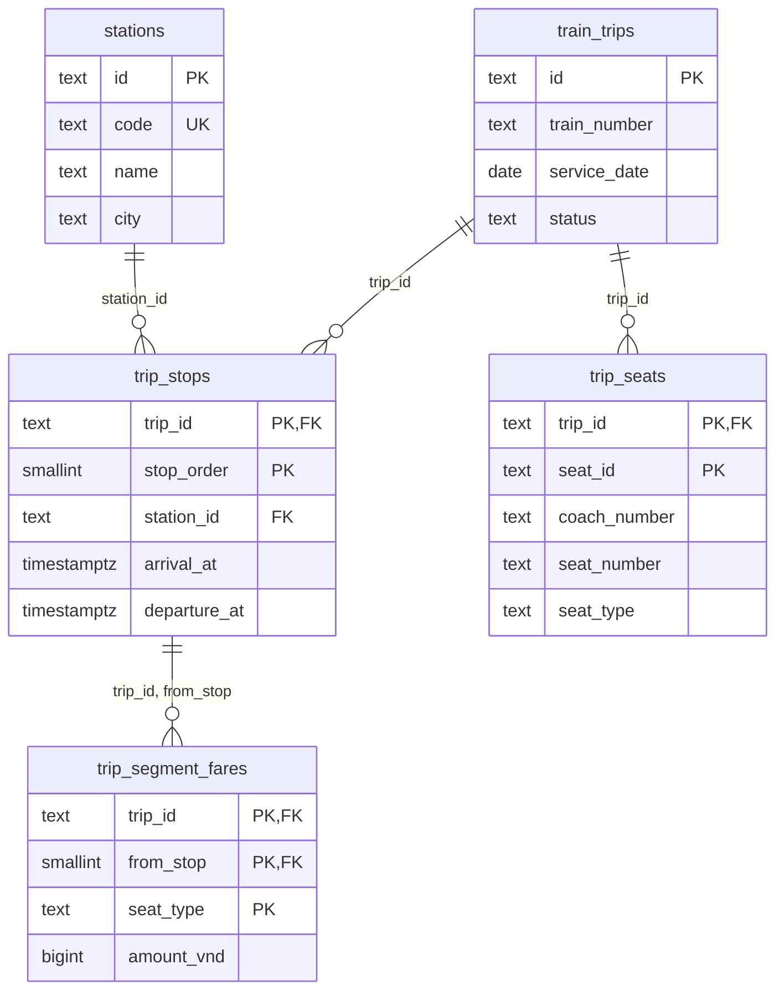
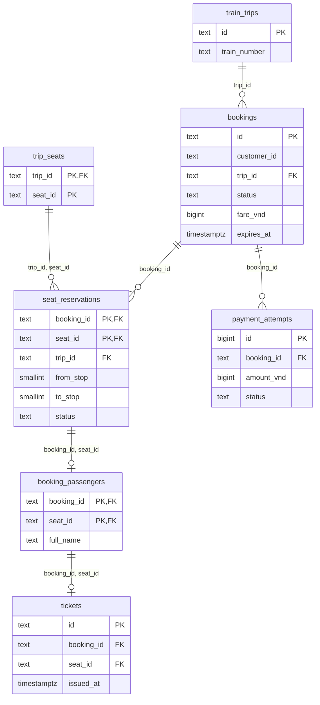
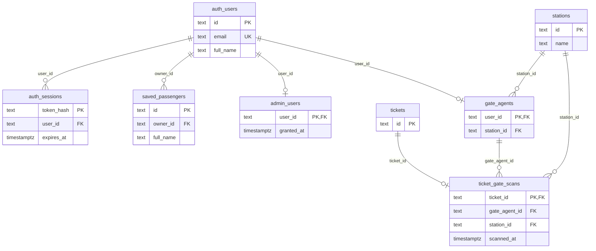
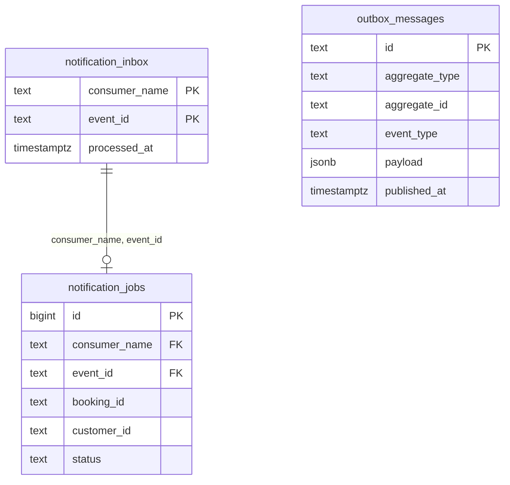

# Database ER diagrams

These diagrams reflect the 19 tables created by `backend/migrations/000001` through
`000014`. They show primary keys, foreign keys, and selected business columns,
not every column, index, or check constraint. Every relationship line below
represents a **database foreign key**. Tables repeated across figures provide
context; they are not extra tables.

For an A4 Word report, export each figure separately as SVG and place it under
its own caption. Figure 2 is the widest and may benefit from a landscape page.
Keep detailed column descriptions in a data dictionary table rather than
shrinking the diagrams to fit all 19 tables on one page.

## Figure 1 — Timetable, seats, and fares

`trip_segment_fares.(trip_id, from_stop)` references
`trip_stops.(trip_id, stop_order)`. Each fare is for one adjacent stop segment
and seat type.

## Figure 2 — Booking, payment, and ticket issuance

The reservation references a seat by the **composite** key
`(trip_id, seat_id)`. A passenger belongs to the reservation identified by
`(booking_id, seat_id)`, and a ticket references that passenger by the same
pair. `bookings.customer_id` is a logical account identifier, **not** a
foreign key to `auth_users` in the current schema.

## Figure 3 — Accounts, administration, and gate checks

`ticket_gate_scans.ticket_id` is both the primary key and a foreign key, so
one ticket can have at most one stored gate scan.

## Figure 4 — Outbox and notification delivery

`notification_jobs.(consumer_name, event_id)` references
`notification_inbox.(consumer_name, event_id)` and is unique. Outbox messages
reach the notification consumer through Kafka; there is **no database foreign
key** from `outbox_messages` to either notification table. The job's
`booking_id` and `customer_id` are also logical references, not foreign keys.
